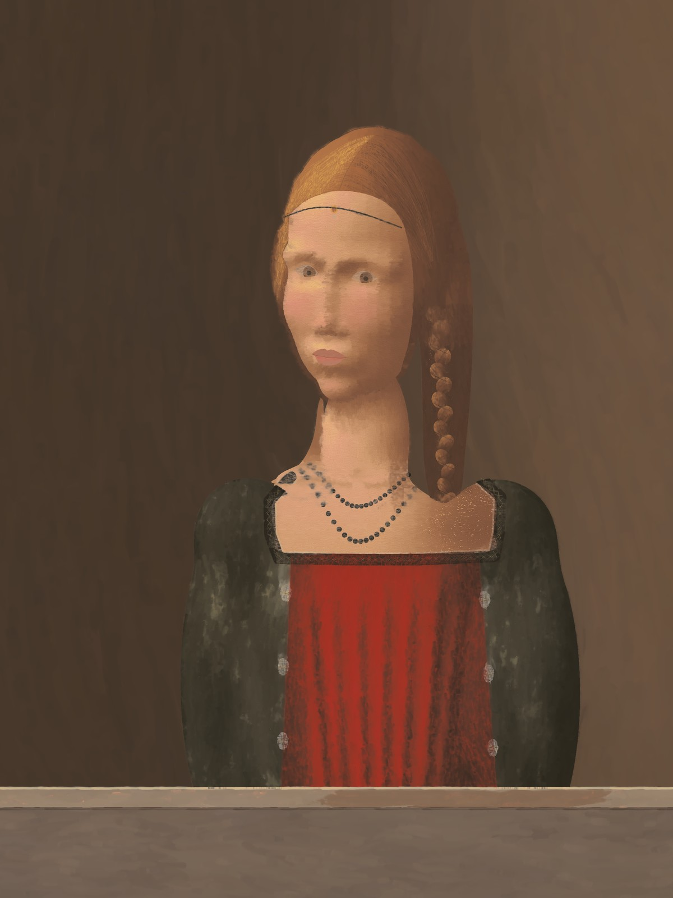

# Portrait of a Young Woman with a Ferronnière

An oil portrait in the manner of the Italian quattrocento. It was painted stroke by stroke in
[claude-paint](https://github.com/aliceisjustplaying/claude-paint), a physical oil-paint
simulator: simulated bristles carry wet paint over a primed linen canvas, the paint dries on a
clock, and layers combine by Kubelka–Munk optics. Every colour was knifed together from
period-appropriate tubes. Nothing was drawn as pixels.



| file | |
|---|---|
| `images/portrait_varnished.png` | the finished painting, varnished (2400 × 3200) |
| `images/portrait_aged.png` | the same picture with the engine's craquelure, as if centuries old |
| `images/portrait_unvarnished.png` | as it left the easel, before varnish |
| `process/` | the stages, from the 3-D head model to the finished picture |
| `painting_log.lua` | the complete painting: replaying it with the easel repaints the same canvas |
| `lua/` | the stages as written, chunk by chunk |

## How it was made

**The palette** used only tubes a Florentine workshop could have had: lead white, vermilion,
red earth, yellow ochre, raw umber, bone black, green earth, rose madder, verdigris (copper
green), smalt and Naples yellow.

1. **Ground.** A fine linen was knifed smooth with lead white, like a gessoed panel. The top
   coat was toned a warm buff, standing in for the *imprimatura*.
2. **Cartoon.** The head was built as a 3-D solid out of smoothly joined ellipsoids (skull,
   cheeks, brow, nose, lips, eye sockets and eyeballs), then turned three-quarters toward the
   light. A soft "wrapped" light computed from its surface normals drives all the flesh
   modelling, which gives the sfumato. The eyelids, irises, nostrils and lips were drawn in
   the head's own coordinates and projected onto the turned surface. A pencil underdrawing
   lays them in.
3. **Dead colouring.** Lean paint goes on everywhere. The flesh is a green-grey *verdaccio*
   (bone black, ochre, green earth and lead white), as the Italians underpainted it.
4. **Flesh.** A six-step ladder from umber shadow to Naples-yellow light, with cool greenish
   half-tones and the rose of the cheeks worked in wet. It is laid in short strokes, then
   veiled with thin light *velature*.
5. **Features.** Warm brown irises under heavy lids, a soft lid line, catchlights from the
   window on the left, shaped lips and the faintest lift at their corners.
6. **Costume and setting.** Hair with a centre parting and a braid down the back
   (*coazzone*). A ferronnière cord with a ruby and a pearl. A crimson bodice with pleated
   folds, sleeves of dark green velvet tied with gold points and puffed with linen, a black
   velvet band with gold knotwork, a double strand of jet beads. A stone parapet.
7. **Finishing.** The engine's varnish (and, for the aged version, its craquelure).

## Rendering it yourself

```sh
./render.sh            # clones and builds claude-paint, replays painting_log.lua, writes the PNGs
```

It needs git, Rust (rustup) and a C compiler (Xcode command-line tools on a Mac), and about
8 GB of RAM at peak. The log names its own tube box and engine version, so the replay paints
the same canvas, then `easel finish` makes the varnished and aged versions.

`tools/e` is the wrapper used for live painting (`friedrich` box); `tools/preview.sh` and
`tools/dump2png.py` render the 3-D head model's light as an image, which is how the head was
sculpted before any paint went on.
